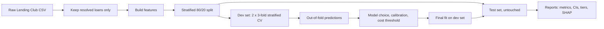
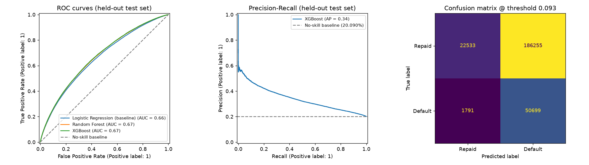
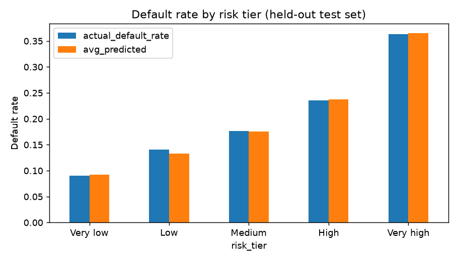
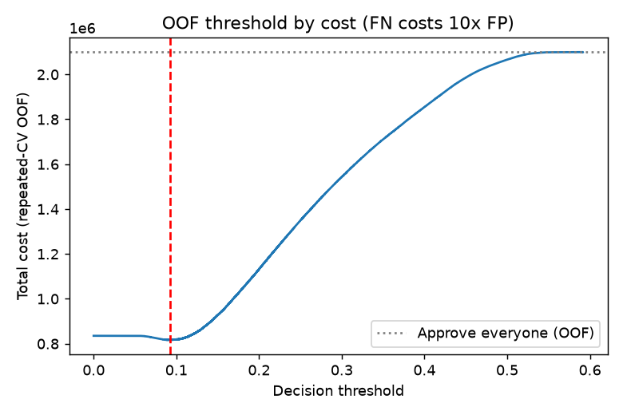
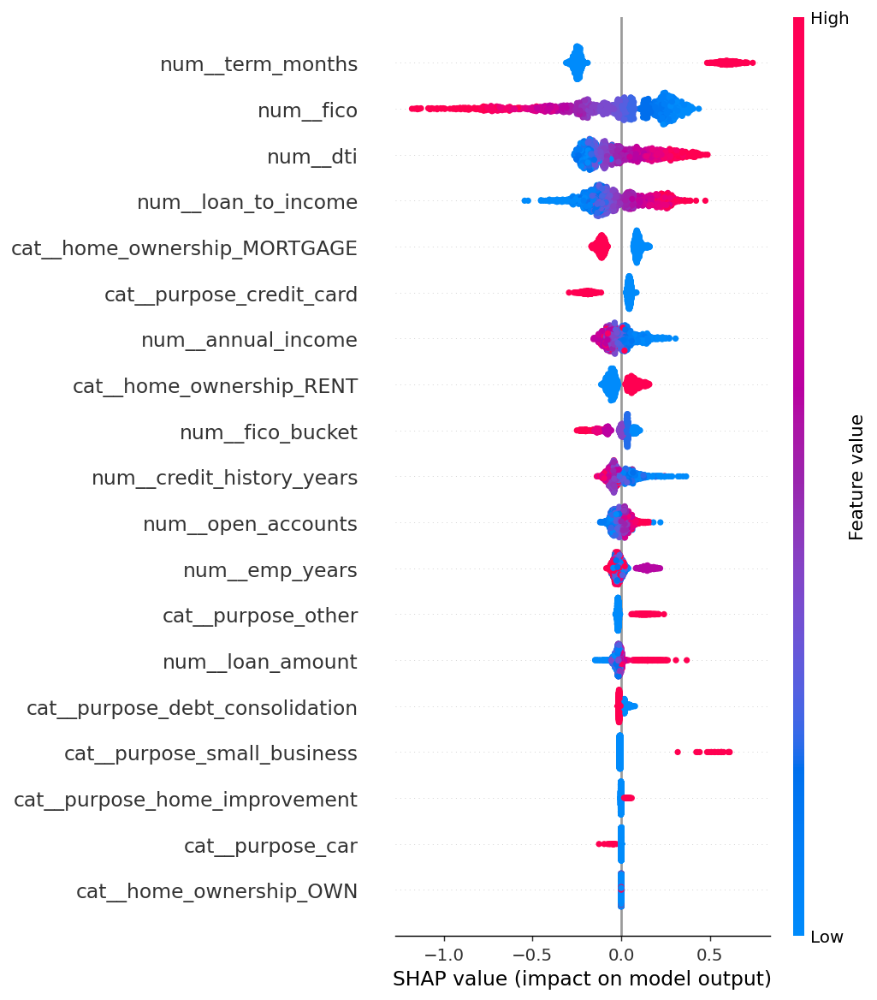

# Loan Default Risk Predictor


An end-to-end credit-risk machine-learning pipeline trained on **1.3 million resolved Lending Club loans**. It predicts the probability that a borrower defaults, calibrates that probability, turns it into a risk tier and a cost-based approve/review decision, and explains *why* with SHAP.

The project started as a follow-up to the J.P. Morgan Quantitative Research job simulation (probability of default and FICO bucketing). It was trained twice, **without FICO** and **with FICO**, so the effect of FICO (and of J.P. Morgan-style dynamic-programming FICO buckets) is measured rather than assumed.

## Headline results

| | Run A: no FICO | Run B: with FICO |
|---|---|---|
| Best model | XGBoost | XGBoost |
| Test ROC-AUC (95% CI) | 0.669 (0.666-0.672) | **0.690 (0.687-0.692)** |
| Test PR-AUC (no-skill = 0.20) | 0.340 | **0.356** |
| Top vs bottom risk tier default rate | 36% vs 9% (4.0x) | **37% vs 7% (5.2x)** |
| Expected cost saved vs best naive rule, 3:1 / 5:1 | 15% / 16% | **17% / 20%** |

- Adding FICO raised test ROC-AUC by about **0.02**, and the confidence intervals do not overlap.
- **Dynamic-programming FICO buckets added nothing** over raw FICO in a logistic-regression ablation (0.6791 vs 0.6790).
- Predicted and actual default rates agree **within 0.7 percentage points** in every risk tier.
- The model's business value depends on the cost ratio of a missed default to a false alarm. It is largest around **3:1 to 5:1** and small at 10:1.

> [!NOTE]
> The two runs use slightly different samples and splits (Run A: 261,278 test loans; Run B: 260,000), so only differences larger than the confidence intervals should be read as real.

## Contents
1. [Dataset](#dataset)
2. [Features and leakage control](#features-and-leakage-control)
3. [Methodology](#methodology)
4. [Experiment A: without FICO](#experiment-a-without-fico)
5. [Experiment B: with FICO](#experiment-b-with-fico)
6. [FICO ablation](#fico-ablation)
7. [Calibration and risk tiers](#calibration-and-risk-tiers)
8. [Cost-sensitive decisions](#cost-sensitive-decisions)
9. [Explainability (SHAP)](#explainability-shap)
10. [Reports index](#reports-index)
11. [Reproduce it](#reproduce-it)
12. [Project structure](#project-structure)
13. [Limitations](#limitations)
14. [Design decisions](#design-decisions)

## Dataset

Source: the Lending Club accepted-loans file `accepted_2007_to_2018Q4.csv` ([Kaggle: wordsforthewise/lending-club](https://www.kaggle.com/wordsforthewise/lending-club)), about 2.26 million loans.

- **Target:** `default = 1` for *Charged Off* or *Default*, `default = 0` for *Fully Paid*.
- **Excluded:** loans that are still current, late or in a grace period, because their final outcome is unknown.
- **Size after filtering:** about 1.3 million resolved loans with a default rate of about **20%** (Run A: 1,306,387 loans; Run B: 1,300,000 loans, 259,584 defaults).
- **Split:** stratified 80/20 development/test split. The test set is untouched until the final evaluation.

Run B's data is built by `src/prepare_lending_club.py`, which averages `fico_range_low` and `fico_range_high` into a single `fico` column.

## Features and leakage control

| Group | Features |
|---|---|
| Loan | `loan_amount`, `term_months`, `purpose` (one-hot), `loan_to_income` (engineered) |
| Borrower | `annual_income`, `emp_years`, `home_ownership` (one-hot), `dti`, `open_accounts`, `credit_history_years` |
| Credit score (Run B only) | `fico`, `fico_bucket` (dynamic-programming buckets) |

**Deliberately excluded to avoid leakage or circularity:**
- `last_fico_range_*` and `sec_app_fico_range_*` (recorded after the loan or for joint applicants).
- Payment, recovery and other post-origination fields.
- Lender-assigned `grade`, `sub_grade` and `int_rate`, which already encode Lending Club's own risk assessment. Leaving them out is the main reason AUC is modest (see [Limitations](#limitations)).

## Methodology



| Step | What is done | Why |
|---|---|---|
| Imbalance | Balanced class weights (`scale_pos_weight` for XGBoost); judged by PR-AUC and cost, not accuracy | About 1 in 5 loans defaults, so accuracy is misleading |
| FICO buckets | Dynamic programming finds bucket edges that maximise default log-likelihood. Edges are learned **inside each CV fold** | The J.P. Morgan idea turned into a model feature, with no leakage into validation rows |
| Preprocessing | Median imputation, scaling (linear models), one-hot encoding | Keeps each model on suitable inputs |
| Models | Logistic Regression (baseline), Random Forest, XGBoost, plus a raw-FICO ablation (Run B) | A simple baseline, a bagged ensemble and a boosted ensemble |
| Evaluation | Repeated stratified CV (2 repeats of 3 folds); model selected by mean CV PR-AUC | Uses every default for model choice |
| Calibration | Sigmoid calibration fitted on out-of-fold scores | So "20%" really means about 20% of such borrowers default |
| Threshold | Chosen from out-of-fold scores by minimising cost; never from test labels | Prevents tuning on the test set |
| Uncertainty | 300-sample stratified bootstrap gives 95% confidence intervals for test ROC-AUC and PR-AUC | Shows which differences are real |
| Baselines | "Approve everyone" and "Reject everyone" at every cost ratio | A model only counts if it beats the best naive rule |
| Safeguard | Warning when the test set has fewer than 100 defaults | Tiny test sets give unreliable metrics |

## Experiment A: without FICO

Data: the supplied Lending Club file, which had no FICO columns. FICO and FICO-bucket features were left out rather than inferred from grade.

**Test set:** 261,278 loans, 52,490 defaults (20.09%).

| Model | Test ROC-AUC (95% CI) | Test PR-AUC |
|---|---|---|
| Logistic Regression (baseline) | 0.657 (0.655-0.660) | 0.327 |
| Random Forest | 0.667 (0.664-0.670) | 0.337 |
| **XGBoost** | **0.669 (0.666-0.672)** | **0.340** |
| No-skill baseline | 0.500 | 0.201 |

XGBoost clearly beats Logistic Regression, and XGBoost and Random Forest are statistically tied.

## Experiment B: with FICO

Data: the Kaggle accepted-loans file converted with `src/prepare_lending_club.py`. Dynamic-programming FICO bucket edges: `[669, 689, 709, 729, 769, 849]`, giving six groups (up to 669, 670-689, 690-709, 710-729, 730-769, 770-849).

**Test set:** 260,000 loans, 51,917 defaults (19.97%).

| Model | CV ROC-AUC | CV PR-AUC | Test ROC-AUC (95% CI) | Test PR-AUC (95% CI) |
|---|---|---|---|---|
| Logistic Regression (baseline) | 0.6823 +/- 0.0010 | 0.3465 +/- 0.0014 | 0.6791 (0.6762-0.6817) | 0.3436 (0.3408-0.3471) |
| Logistic Regression (raw FICO only) | 0.6823 +/- 0.0010 | 0.3466 +/- 0.0014 | 0.6790 (0.6761-0.6816) | 0.3435 (0.3407-0.3471) |
| Random Forest | 0.6901 +/- 0.0010 | 0.3552 +/- 0.0016 | 0.6884 (0.6858-0.6909) | 0.3536 (0.3504-0.3574) |
| **XGBoost** | **0.6929 +/- 0.0010** | **0.3593 +/- 0.0018** | **0.6899 (0.6871-0.6924)** | **0.3563 (0.3531-0.3601)** |

CV values are means with sample standard deviations across the six validation folds.

> Only the latest Run A (no-FICO) report images are retained in this checkout.
> Run B's metrics are documented above, but its report images are not archived.



- XGBoost and Random Forest are statistically tied, and both beat Logistic Regression clearly.
- Cross-validation and test scores agree closely, so there is no sign of leakage or overfitting.

## FICO ablation

Two questions were tested.

**1. Does FICO help?** Yes. XGBoost's test ROC-AUC rose from 0.669 to 0.690 (non-overlapping intervals), PR-AUC from 0.340 to 0.356, and FICO became the second most important feature in SHAP.

**2. Do dynamic-programming FICO buckets help on top of raw FICO?** No. Logistic Regression with buckets and with raw FICO only are indistinguishable:

| Logistic Regression variant | CV ROC-AUC | Test ROC-AUC |
|---|---|---|
| With DP FICO buckets | 0.6823 | 0.6791 |
| Raw FICO only | 0.6823 | 0.6790 |

This negative result is expected for a few reasons: tree models find their own split points, and a linear model with a well-behaved score gains little from a step transform. The buckets remain useful for presenting risk grades, but they are not needed for accuracy.

## Calibration and risk tiers

Test loans are split into five equal-size tiers by predicted risk. Calibration is good in both runs.

**Run B (with FICO), 52,000 loans per tier:**

| Risk tier | Actual default rate | Predicted |
|---|---|---|
| Very low | 7.2% | 7.4% |
| Low | 13.0% | 12.5% |
| Medium | 18.2% | 17.5% |
| High | 24.1% | 24.3% |
| Very high | 37.4% | 38.0% |

The largest gap is 0.7 percentage points, and the top tier defaults at **5.2x** the rate of the bottom tier. In Run A the same spread was 9.0% to 36.3% (4.0x), again with predicted and actual rates matching closely.

Even the "very low" tier defaults at 7%, so the model ranks borrowers well but cannot identify truly safe loans. That is consistent with an AUC of about 0.69.



## Cost-sensitive decisions

Rejecting a good borrower and approving a defaulter do not cost the same. For each cost ratio (cost of a missed default : cost of a false alarm) the decision threshold is chosen from out-of-fold predictions and compared with the two naive rules. With calibrated probabilities the best threshold is about `1 / (1 + ratio)`, and the thresholds found match that at every ratio.

**Run B, XGBoost:**

| Cost ratio | Best naive rule | Naive cost | Model cost | Cost saved | Loans flagged | Defaults caught | Precision |
|---|---|---|---|---|---|---|---|
| 2:1 | Approve everyone | 103,834 | 95,638 | 7.9% | 13.2% | 27.3% | 41.3% |
| 3:1 | Approve everyone | 155,751 | 128,714 | 17.4% | 27.1% | 47.0% | 34.6% |
| 5:1 | Reject everyone | 208,083 | 166,798 | **19.8%** | 54.6% | 75.4% | 27.6% |
| 10:1 | Reject everyone | 208,083 | 195,795 | 5.9% | 86.5% | 96.0% | 22.2% |

**Run A, XGBoost (for comparison):**

| Cost ratio | Cost saved | Loans flagged | Defaults caught |
|---|---|---|---|
| 2:1 | 6.3% | 12% | 23% |
| 3:1 | 15.4% | 26% | 43% |
| 5:1 | 15.6% | 57% | 75% |
| 10:1 | 2.2% | 91% | 97% |

Where the model helps:
- "Approve everyone" and "reject everyone" cost the same when the ratio is about 4:1, which is `(non-defaults / defaults)`. Near that point neither naive rule works, so the model adds the most value at **3:1 to 5:1**.
- At 10:1, rejecting almost everyone is already close to optimal, so the model saves little.
- The right ratio depends on a lender's real loss per defaulted loan versus profit per repaid loan, so results are shown across a range instead of for one assumed number.



## Explainability (SHAP)

**Run B, mean absolute SHAP value (top 10):**

| Rank | Feature | Mean abs SHAP |
|---|---|---|
| 1 | `term_months` | 0.326 |
| 2 | **`fico`** | **0.262** |
| 3 | `dti` | 0.159 |
| 4 | `loan_to_income` | 0.145 |
| 5 | `home_ownership_MORTGAGE` | 0.104 |
| 6 | `purpose_credit_card` | 0.079 |
| 7 | `annual_income` | 0.063 |
| 8 | `home_ownership_RENT` | 0.063 |
| 9 | `fico_bucket` | 0.062 |
| 10 | `credit_history_years` | 0.055 |

In Run A the top drivers were `term_months` (0.34), `dti` (0.17) and `loan_to_income` (0.12), followed by home ownership, credit-card purpose, credit history and income.



> [!NOTE]
> SHAP shows what the model relies on, not what causes default. `term_months` is partly chosen by the lender based on its own view of the applicant, so it also reflects Lending Club's underwriting.

## Reports index

Training writes outputs to `reports/`, which holds the latest run's artifacts.
Historical report folders are not included in this checkout.

| File | Contents |
|---|---|
| `model_comparison.csv` | CV and test metrics with confidence intervals, thresholds, precision, recall, cost, plus the approve/reject-everyone baselines |
| `cost_ratio_comparison.csv` | Every model and both naive rules at 2:1, 3:1, 5:1 and 10:1 |
| `risk_tiers.csv` | Actual vs predicted default rate by risk tier |
| `feature_importance_shap.csv` | Mean absolute SHAP value per feature |
| `evaluation.png` | ROC curves, precision-recall curve, confusion matrix |
| `threshold_cost.png` | Total cost across decision thresholds |
| `risk_tiers.png` | Default rate by risk tier |
| `shap_summary.png` | SHAP summary plot |

The Experiment A and B result summaries above are recorded in this README; only the latest report files in `reports/` are available as artifacts.

## Reproduce it

```bash
pip install -r requirements.txt
```

**Experiment B (with FICO):**
```bash
# 1. Download accepted_2007_to_2018Q4.csv from Kaggle (wordsforthewise/lending-club) into data/
# 2. Convert it to the project's format (writes data/loans.csv)
python -m src.prepare_lending_club data/accepted_2007_to_2018Q4.csv --rows 1300000
# 3. Train and evaluate
python -m src.train
```

**Experiment A (without FICO):** place a Lending Club CSV without FICO columns at `data/loan_lenders.csv` and run `python -m src.train`. If both files are present, `data/loan_lenders.csv` takes precedence, so rename it when reproducing Experiment B.

**Other commands:**
```bash
python -m src.predict        # score an example borrower
streamlit run app.py         # open the web app (score a borrower, view metrics and SHAP)
```

**Deploy the Streamlit app:** deploy this GitHub repository on
[Streamlit Community Cloud](https://share.streamlit.io/), select branch `main`
and entrypoint `app.py`. The trained model is included in the repository. Do not
deploy this Streamlit entrypoint to Vercel; Vercel expects a serverless Python
handler and does not run Streamlit's persistent app server.

If neither data file is present, the pipeline falls back to a built-in synthetic dataset (20,000 loans, about 12% defaults) so everything still runs.

**Canonical CSV format:**
`fico, annual_income, loan_amount, term_months, emp_years, open_accounts, credit_history_years, purpose, home_ownership, dti, default` (`default` = 1 means the loan defaulted; `fico` can be absent for Experiment A).

> The raw datasets are not stored in the repository. The trained model file (`models/loan_model.joblib`) is included so the deployed app can score borrowers without access to the training data.

## Project structure

```
loan-default-predictor/
├── app.py                        # Streamlit app
├── requirements.txt
├── src/
│   ├── data.py                   # data loading (Lending Club, canonical CSV, synthetic fallback)
│   ├── prepare_lending_club.py   # raw Lending Club file -> data/loans.csv
│   ├── buckets.py                # dynamic-programming FICO bucketing
│   ├── preprocess.py             # imputation, scaling, encoding, FicoBucketer
│   ├── model_utils.py            # calibrator and calibrated model wrapper
│   ├── train.py                  # CV, calibration, threshold, evaluation, SHAP
│   └── predict.py                # score a single borrower
├── data/                         # not tracked
├── models/                       # trained model and config
├── reports/                      # latest run
│   └── cost_ratio_comparison.csv
```

## Limitations

- **Modest AUC (about 0.69).** Lender grade and interest rate are excluded on purpose, and models that use them usually score higher. The comparison is honest, but not state of the art.
- **Accepted loans only.** Rejected applicants are not in the data, so the model is trained on a selected population.
- **No time-based split.** Loans from 2007-2018 are split at random, so performance on future loans in a different economy may be lower.
- **Cost ratio is an assumption.** Real loss and profit figures were not available, so results are shown across 2:1 to 10:1.
- **No fairness audit** and no monitoring for data drift.
- **Run-to-run comparisons are approximate**, because the two experiments use different samples and test splits.

## Design decisions

1. **Accuracy is misleading** when only about 1 in 5 loans defaults, so models are judged by ROC-AUC, PR-AUC and expected cost.
2. **No leakage:** FICO bucket edges are learned inside each CV fold, post-loan columns and lender grades are excluded, and thresholds come from out-of-fold predictions.
3. **Calibration matters for lending:** a predicted 20% should mean 20%, and calibrated probabilities make the cost-based threshold principled (`1 / (1 + ratio)`).
4. **Report uncertainty:** bootstrap confidence intervals show that XGBoost and Random Forest are tied, but that both beat Logistic Regression and that FICO helps.
5. **Report negative results:** DP FICO buckets did not beat raw FICO, so the final model relies on the raw score.
6. **Beat the naive baselines:** a model is only useful if it beats "approve everyone" and "reject everyone" at the chosen cost ratio.

## Author

Hardik Guwalani - [GitHub](https://github.com/hardik444) - [LinkedIn](https://linkedin.com/in/hardikguwalani)
